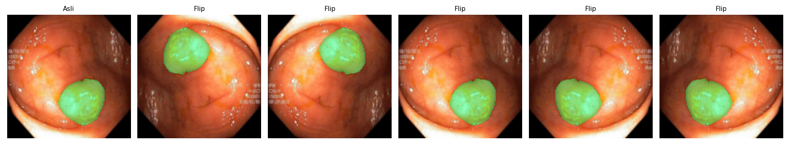
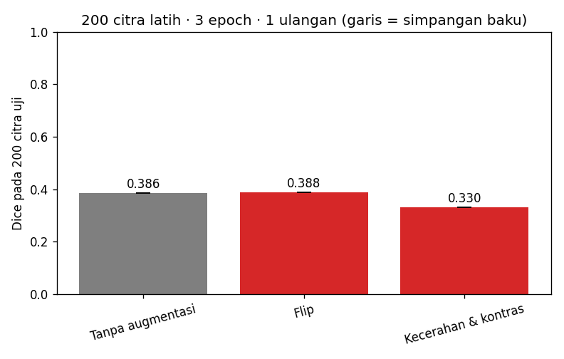
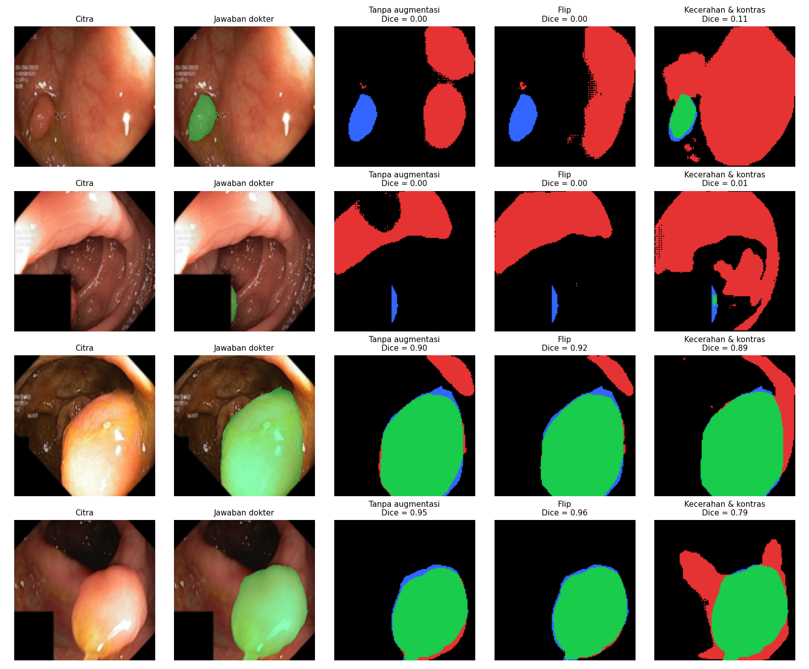

# Segmentasi Polip pada Citra Kolonoskopi dengan U-Net

<!--
  TEMPLATE LAPORAN — Tugas P10 Kecerdasan Buatan (BM25-41204), Teknik Biomedis ITERA.
  Petunjuk lengkap: https://mctm.web.id/ai-bm/tugas

  Cara memakai:
  - Ganti semua teks yang diawali "✍️" dengan tulisan kelompokmu, lalu hapus tanda ✍️-nya.
  - Blok komentar seperti ini adalah petunjuk; tidak tampil di GitHub. Boleh dihapus.
  - Gambar diambil dari folder hasil/ yang dibuat otomatis oleh notebook.
  - Jangan hapus judul-judul bagian (##).
-->

**Tugas P10 — Kecerdasan Buatan (BM25-41204), Teknik Biomedis ITERA**

## Anggota kelompok

| Nama | NIM | Username GitHub | Kontribusi utama |
|---|---|---|---|
| Nur Halimah | 123430075 | nur123430075-stack | Membuat Laporan |
| Triya Wulandari | 123430024 | triya123430024-jpg | Membuat Laporan |
| Riya Dwi Sioni | 123430036 | riya123430036-png | Menjalankan Eksperimen Augmentasi |

## 1. Pertanyaan

Augmentasi apa yang membantu U-Net menemukan polip pada citra kolonoskopi, dan augmentasi apa yang tidak? Kenapa?

## 2. Data & pengaturan

- Dataset: Kvasir-SEG (1000 citra kolonoskopi + mask polip), diperkecil ke 128 × 128 piksel.
- Data uji: 200 citra (tetap). Data latih: 200 citra per ulangan.
- Model: U-Net mini (±0,5 juta parameter), 40 epoch, 3 ulangan per skenario.
- Dijalankan di: Google Colab.


## 3. Skenario augmentasi & hipotesis

| Skenario | Augmentasi (kode) | Alasan klinis | Hipotesis: Dice naik/turun/sama? |
|---|---|---|---|
| Tanpa augmentasi | — | Pembanding | — |
| Flip | v2.RandomHorizontalFlip() dan v2.RandomVerticalFlip() | Posisi dan orientasi kamera kolonoskopi dapat berubah saat pemeriksaan | Dice naik karena model belajar mengenali polip dari berbagai orientasi |
| Kecerahan & kontras | v2.ColorJitter(brightness=0.3, contrast=0.3) | Pencahayaan dan jarak kamera terhadap polip dapat memengaruhi tampilan citra. | Dice naik karena model lebih tahan terhadap variasi pencahayaan. |

Contoh augmentasi yang dicoba:


## 4. Hasil

| Skenario | Dice (rata-rata ± sb) | IoU (rata-rata ± sb) | Dice tiap ulangan |
|---|---|---|---|
| Tanpa augmentasi | 0.586 ± 0.013 | 0.476 ± 0.013 | 0.568, 0.599, 0.592 |
| Flip | 0.627 ± 0.045 | 0.517 ± 0.060 | 0.584, 0.669, 0.647 |
| Kecerahan & kontras | 0.587 ± 0.041 | 0.469 ± 0.040 | 0.622, 0.530, 0.608 |



## 5. Analisis peta kesalahan



Gambar 1. Peta kesalahan: citra kolonoskopi, mask dokter (jawaban dokter), dan prediksi U-Net untuk tiga skenario pada empat citra uji.

Setiap baris pada Gambar 1. adalah satu citra uji. Kolom pertama adalah citra kolonoskopi, kolom kedua adalah mask polip dari dokter (jawaban dokter, warna hijau muda), dan tiga kolom terakhir adalah hasil prediksi U-Net untuk skenario Tanpa augmentasi, Flip, dan Kecerahan & kontras, lengkap dengan nilai Dice per citra. Pada kolom prediksi:

- Hijau = bagian polip yang berhasil ditemukan model (TP).
- Biru = bagian polip yang terlewat oleh model (FN).
- Merah = area bukan polip yang salah ditandai sebagai polip (FP).
- Hitam = latar yang benar dikenali sebagai bukan polip (TN).

Secara klinis, FN adalah kesalahan yang paling berbahaya karena polip yang terlewat dapat berkembang menjadi kanker, sedangkan FP dapat memicu pemeriksaan atau biopsi yang sebenarnya tidak diperlukan.

Adapun nilai dice citra pada Gambar 1 sebagai berikut.

| Citra contoh | Tanpa augmentasi | Flip | Kecerahan & kontras |
|---|:---:|:---:|:---:|
| 1 (polip besar, dekat lumen gelap) | 0,00 | 0,00 | 0,44 |
| 2 (polip kecil, mukosa kemerahan) | 0,00 | 0,00 | 0,00 |
| 3 (polip jelas, berbatas tegas) | 0,95 | 0,93 | 0,96 |
| 4 (polip jelas, berbatas tegas) | 0,96 | 0,94 | 0,94 |
| Rata-rata 4 citra contoh | 0,48 | 0,47 | 0,59 |

Pada hasil citra 1, seluruh polip berwarna biru dengan Dice 0,00 pada skenario Tanpa augmentasi dan Flip. Artinya tidak ada satu pun piksel polip yang ditemukan (FN total), dan tidak ada FP. Hanya skenario Kecerahan & kontras yang mulai menemukan polip (Dice 0,44): dua bagian polip berwarna hijau, sebagian besar masih biru, dan muncul satu bercak merah (FP) di bagian bawah citra pada area mukosa oranye yang bukan polip. Dugaan kami, kontras yang ekstrem antara polip yang pucat dan terang dengan lumen yang sangat gelap menyulitkan model, dan variasi kecerahan serta kontras saat pelatihan membantu model menghadapi kondisi tersebut. Dugaan ini belum diuji secara terpisah.

Pada citra 2, Ketiga skenario menghasilkan Dice 0,00 karena polip kecil tersebut tetap berwarna biru (terlewat). Warna polip mirip dengan mukosa di sekitarnya yang kemerahan, ditambah bintik merah dan pantulan cahaya, sehingga kontrasnya rendah. Perbedaan antarskenario ada pada FP: skenario Tanpa augmentasi menghasilkan bercak merah besar di kiri bawah, skenario Flip tidak menghasilkan FP, dan skenario Kecerahan & kontras hanya menyisakan serpihan merah yang sangat kecil. Jadi kedua augmentasi tampak mengurangi salah tandai, tetapi tidak menyelamatkan polip yang terlewat.

Sedangkan pada citra 3 dan 4, semua skenario menemukan polip dengan baik (Dice 0,93 sampai 0,96). Kesalahan yang tersisa hanya berupa garis tipis merah atau biru di tepi polip (kesalahan batas). Pada citra 3 urutan Dice adalah Kecerahan & kontras (0,96), Tanpa augmentasi (0,95), lalu Flip (0,93). Pada citra 4, Tanpa augmentasi justru sedikit tertinggi (0,96) dibanding Flip dan Kecerahan & kontras (masing-masing 0,94). Selisih 0,01 sampai 0,03 ini kecil dan mungkin masih berada dalam variasi antarulangan.

Pada empat citra contoh, hipotesis Flip (hipotesis: Dice naik) tidak didukung. Dice sama pada citra 1 dan 2 (0,00) dan sedikit lebih rendah daripada Tanpa augmentasi pada citra 3 dan 4 (masing-masing turun 0,02). Dugaan kami, polip yang terlihat dari berbagai posisi sudah cukup tercakup di data latih, dan flip hanya memutar atau mencerminkan citra tanpa menambah variasi tampilan seperti warna, tekstur, dan kontras. Kegagalan pada citra 1 dan 2 berkaitan dengan kontras dan ukuran polip, bukan dengan orientasi, sehingga wajar bila flip tidak membantu.

Hipotesis Kecerahan & kontras (hipotesis: Dice naik) didukung sebagian. Skenario ini adalah satu-satunya yang menaikkan Dice pada citra 1 (dari 0,00 menjadi 0,44) dan menjadi yang tertinggi pada citra 3. Namun pada citra 2 tidak ada perbaikan, dan pada citra 4 nilainya sedikit di bawah Tanpa augmentasi. Rata-rata yang lebih tinggi (0,59 dibanding 0,48) pada empat citra ini terutama berasal dari satu citra, sehingga belum cukup untuk menyimpulkan bahwa augmentasi ini selalu membantu.

Dari hasil juga didapatkan bahwa pada polip yang jelas dan berbatas tegas (citra 3 dan 4), ketiga skenario sama-sama baik dan perbedaannya hanya di tepi. Kesalahan besar terkonsentrasi pada dua kasus sulit: polip yang sangat besar dengan kontras ekstrem terhadap lumen (citra 1) dan polip yang sangat kecil dengan warna mirip mukosa (citra 2). Pada kasus sulit inilah augmentasi mengubah hasil, bukan pada kasus yang mudah. Hal ini menunjukkan bahwa augmentasi yang berkaitan dengan tampilan citra (kecerahan dan kontras) lebih relevan untuk kasus sulit daripada augmentasi geometri seperti flip. Polip kecil berkontras rendah seperti pada citra 2 masih terlewat oleh semua skenario, dan ini perlu menjadi perhatian karena merupakan jenis FN yang berbahaya secara klinis.

Pada augmentasi ini, terdapat beberapa keterbatasan dari peta kesalahan yang dihasilkan yaitu:
- Peta kesalahan hanya menampilkan empat citra contoh sehingga tidak mewakili seluruh data uji. Kesimpulan akhir harus bersandar pada tabel Dice/IoU rata-rata ± simpangan baku pada Bagian 4.
- Selisih Dice sebesar 0,01 sampai 0,03 pada citra 3 dan 4 belum tentu bermakna bila lebih kecil daripada simpangan baku antarulangan.
- Penjelasan penyebab (kontras ekstrem, warna mirip mukosa, orientasi) merupakan dugaan dari pengamatan visual dan belum diuji dengan eksperimen terpisah.

dari hasil peta kesalahan secara keseluruhan, augmentasi Kecerahan & kontras membantu pada kasus sulit yang dipengaruhi pencahayaan dan kontras (citra 1), sedangkan Flip tidak memberi perbaikan pada contoh yang diamati. Kedua augmentasi tampak mengurangi salah tandai (FP) pada citra 2, tetapi polip kecil berkontras rendah tetap terlewat (FN). Pada polip yang jelas, semua skenario hampir setara.

## 6. Pembahasan & kesimpulan

Pembahasan

Ringkasan perbandingan hipotesis di Bagian 3 dengan hasil yang kami amati dapat dilihat pada tabel di bawah ini:

| Skenario | Hipotesis | Hasil yang diamati | Status |
|---|---|---|---|
| Flip | Dice naik karena model mengenali polip dari berbagai orientasi | Dice sama pada citra 1 dan 2 (0,00) dan turun 0,02 pada citra 3 dan 4 dibanding Tanpa augmentasi | Tidak terbukti |
| Kecerahan & kontras | Dice naik karena model lebih tahan terhadap variasi pencahayaan | Naik pada citra 1 (0,00 menjadi 0,44), tertinggi pada citra 3, tidak berubah pada citra 2, sedikit turun pada citra 4 | Terbukti sebagian |

Pada tabel Dice/IoU di Bagian 4, Dice rata-rata ± simpangan baku dari tiga ulangan adalah [ISI] untuk Tanpa augmentasi, [ISI] untuk Flip, dan [ISI] untuk Kecerahan & kontras. Selisih antarskenario [ISI: lebih besar / lebih kecil] daripada simpangan baku, sehingga perbedaannya [ISI: cukup meyakinkan / belum dapat dipastikan bermakna].

Pada hasil yang didapatkan, flip hanya mencerminkan citra sehingga bentuk, warna, dan kontras polip tetap sama. Polip pada citra kolonoskopi sudah muncul pada berbagai posisi di data latih, jadi flip tidak menambah variasi yang benar-benar baru. Kegagalan pada citra 1 dan 2 berkaitan dengan kontras dan ukuran polip, bukan dengan orientasi, sehingga wajar bila flip tidak memperbaikinya. Ini adalah dugaan dari pengamatan peta kesalahan dan belum diuji dengan eksperimen terpisah.

Pada citra 1, polip besar dan pucat bersebelahan dengan lumen yang sangat gelap sehingga kontrasnya ekstrem. Variasi kecerahan dan kontras saat pelatihan tampaknya membantu model menghadapi kondisi pencahayaan seperti ini, dan hanya skenario ini yang mulai menemukan polip tersebut. Namun pada citra 2, polip kecil yang warnanya mirip mukosa kemerahan tetap terlewat. Dugaan kami, perubahan kecerahan dan kontras mengubah seluruh citra secara merata sehingga tidak menambah perbedaan antara polip dan mukosa di sekitarnya. Artinya, augmentasi ini membantu untuk kesulitan yang disebabkan pencahayaan, tetapi tidak untuk kesulitan yang disebabkan oleh kemiripan warna.

Penelitian Sánchez-Peralta dkk. (2020) melaporkan bahwa transformasi berbasis piksel seperti perubahan kecerahan dan kontras meningkatkan performa segmentasi polip pada dataset CVC-EndoSceneStill, sedangkan pada Kvasir-SEG transformasi geometri seperti rotasi dan shear memberi peningkatan yang lebih besar. Mereka juga menemukan bahwa menggabungkan semua transformasi tidak selalu lebih baik. Hasil kami sejalan dalam hal bahwa kecerahan dan kontras bermanfaat, tetapi berbeda dalam hal flip yang tidak memberi peningkatan. Perbedaan ini dapat berasal dari jenis transformasi (flip berbeda dari rotasi dan shear), arsitektur model, jumlah data latih, dan jumlah ulangan. Hal ini juga sejalan dengan gambaran umum dalam Shorten dan Khoshgoftaar (2019) bahwa augmentasi hanya efektif bila variasi yang ditambahkan memang sesuai dengan variasi yang muncul pada data nyata.

Pada kolonoskopi, polip yang tidak terdeteksi (FN) lebih berbahaya daripada salah tandai (FP), karena polip yang terlewat dapat berkembang menjadi kanker (Leufkens dkk., 2012). Dalam pengamatan kami, polip kecil berkontras rendah (citra 2) terlewat oleh semua skenario, sehingga jenis polip ini perlu mendapat perhatian khusus bila model akan dikembangkan lebih lanjut. Augmentasi yang kami uji tampak mengurangi FP pada citra tersebut, tetapi belum menyelesaikan masalah FN.

Kesimpulan
1. Kecerahan & kontras membantu pada kasus yang sulit karena pencahayaan dan kontras (citra 1), tetapi tidak pada semua citra. Pada polip yang jelas dan berbatas tegas, perbedaannya sangat kecil.
2. Flip tidak meningkatkan Dice pada contoh yang diamati karena hanya mencerminkan citra tanpa menambah variasi warna dan kontras, sementara sumber kegagalan model terletak pada kontras dan ukuran polip, bukan pada orientasi.
3. Polip kecil dengan warna mirip mukosa (citra 2) tetap terlewat oleh semua skenario. Ini adalah jenis kesalahan yang paling berbahaya secara klinis.
4. Kesimpulan ini berdasarkan empat citra contoh dan tiga ulangan, sehingga perlu dikonfirmasi dengan data yang lebih banyak.

## 7. Pembagian kerja

| Nama | NIM | Username GitHub | Bagian yang dikerjakan |
|---|---|---|---|
| Nur Halimah (ketua) | 123430075 | nur123430075-stack | Membuat repositori dan mengundang anggota; Menyusun laporan pada bagian 5 (peta kesalahan) dan bagian 7 (pembagian kerja); mengisi form pengumpulan. |
| Triya Wulandari | 123430024 | triya123430024-jpg | Menyusun laporan pada bagian 6 (pembahasan dan kesimpulan) dan bagian 8 (penggunaan AI) |
| Riya Dwi Sioni | 123430036 | riya123430036-png | Menjalankan eksperimen akhir; Menyusun laporan bagian 2 (data dan pengaturan); bagian 3 (skenario, augmentasi, dan hipotesis); dan bagian 4 (hasli) |

## 8. Penggunaan AI

| Alat AI | Digunakan untuk |
|---|---|
| ChatGPT (GPT) | Memahami instruksi tugas, yaitu menjabarkan kalimat-kalimat pada perintah tugas ke dalam bahasa yang lebih mudah dipahami sehingga kami mengerti apa saja yang harus dikerjakan. |
| Claude | Memahami aturan penggunaan terminal dan git (git pull, git add, git commit, git push, serta pemecahan masalah ketika terminal tidak bisa mengetik); membantu memahami cara menjalankan eksperimen di notebook; menjelaskan cara menganalisis hasil, yaitu membaca peta kesalahan, tabel Dice/IoU, serta jenis kesalahan FP dan FN; serta mencari referensi. |

## Cara menjalankan ulang

```bash
uv sync
uv run jupyter lab segmentasi_polip.ipynb
```

Atau buka notebook di Google Colab (Runtime → Change runtime type → T4 GPU).

## Referensi

- Jha, D., dkk. (2020). Kvasir-SEG: A Segmented Polyp Dataset. *MultiMedia Modeling (MMM 2020)*, 451–462. doi:10.1007/978-3-030-37734-2_37
- Leufkens, A. M., dkk. (2012). Factors Influencing the Miss Rate of Polyps in a Back-to-Back Colonoscopy Study. *Endoscopy*, 44(5), 470–475. doi:10.1055/s-0031-1291666
- Ronneberger, O., Fischer, P., & Brox, T. (2015). U-Net: Convolutional Networks for Biomedical Image Segmentation. *MICCAI*. arXiv:1505.04597.
- Sánchez-Peralta, L. F., dkk. (2020). Unravelling the Effect of Data Augmentation Transformations in Polyp Segmentation. *International Journal of Computer Assisted Radiology and Surgery*, 15(12), 1975–1988. doi:10.1007/s11548-020-02262-4
- Shorten, C., & Khoshgoftaar, T. M. (2019). A Survey on Image Data Augmentation for Deep Learning. *Journal of Big Data*, 6, 60. doi:10.1186/s40537-019-0197-0
- Taha, A. A., & Hanbury, A. (2015). Metrics for Evaluating 3D Medical Image Segmentation: Analysis, Selection, and Tool. *BMC Medical Imaging*, 15, 29. doi:10.1186/s12880-015-0068-x